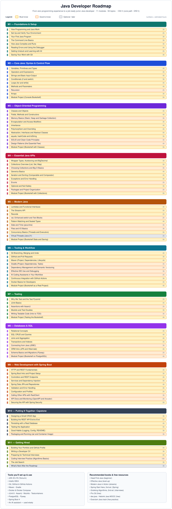

# Java Developer Roadmap

[](https://github.com/vnovakovskyi/java-roadmap/actions/workflows/vault.yml)
[](https://github.com/vnovakovskyi/java-roadmap/actions/workflows/links.yml)

A structured, hands-on path from **zero programming experience** to a **job-ready junior Java
developer** — built as an [Obsidian](https://obsidian.md) vault you can download and work through.

It covers everything you actually need — the knowledge, the tools, the books, and the job search —
organized into **11 modules** and **93 hands-on topics**, from "what is a program" all the way to a
tested, secured Spring Boot REST API running in Docker. Up to date for **Java 25 (LTS)** and
**Spring Boot 4**.

## What's inside

- **Every topic follows the same loop:** Learning Objectives → Learn (curated, free resources with
  direct links) → Concepts → Practice → **Self-check** (questions with collapsible answers) →
  Definition of Done → Next.
- **Bookshelf — one project, seven versions.** Modules 2–8 each end with a new version of the same
  app: a console program → classes → collections → modern Java and files → a real build with CI →
  tests → PostgreSQL.
- **A capstone of your own design** (Module 10) and a **Getting Hired** module (Module 11):
  portfolio, CV, interviews, coding practice, and the job search.
- **Learning with AI, done right:** how to use assistants as a tutor without letting them do your
  practice for you — and how to use them productively on the job.
- **A live progress dashboard** (Obsidian Bases) and a clickable visual map (`Roadmap.canvas`).

## The path at a glance



> In Obsidian you can also open the interactive **`Roadmap.canvas`** to navigate straight to any topic.

1. **Foundations & Setup** — how programming and Java work; install, run, debug; Git from day one
2. **Core Java** — syntax, types, control flow, methods, recursion, arrays
3. **Object-Oriented Programming** — classes, memory, encapsulation, inheritance, interfaces, SOLID
4. **Essential Java APIs** — numbers, collections, generics, sorting, exceptions, enums, Optional
5. **Modern Java** — lambdas, streams, records, pattern matching, date/time, files, concurrency
6. **Tooling & Workflow** — Git & GitHub, Maven, Gradle, CI with GitHub Actions, Docker, AI assistants
7. **Testing** — JUnit 6, AssertJ, Mockito, writing testable code
8. **Databases & SQL** — SQL, joins, transactions & indexes, JDBC, JPA/Hibernate, Flyway
9. **Web Development with Spring Boot** — REST, data, validation, config, REST clients, docs, security
10. **Capstone** — your own CRUD app, end-to-end: tested, documented, containerized
11. **Getting Hired** — portfolio, CV, technical interviews, coding practice, the job search

Target: roughly **7 months at ~10–12 hours/week** (~325 h; the core `must` path is ~255 h). Go at
your own pace.

## How to use this as an Obsidian vault

1. Install [Obsidian](https://obsidian.md) (free, desktop and mobile).
2. Download this repo: **Code → Download ZIP**, then unzip it — or `git clone` it.
3. In Obsidian: **Open folder as vault** → choose the downloaded `java-roadmap` folder.
4. Open **`Home.md`** — that's your home base. Bookmark it.
5. Begin with **`Tools & Setup`**, then start Module 1 and work through the topics in order.

Tick the checkboxes and update each note's `status` as you progress; the built-in Dashboard tracks
everything for you.

> The Dashboard uses Obsidian's built-in **Bases**. If it doesn't render on your device, the
> **Module Index** inside `Home.md` gives you the same navigation.

## Browse the topics on GitHub

Prefer to read in the browser first? Every topic is a plain Markdown file. (Links *between* notes
use Obsidian's `[[wikilinks]]`, which only work inside Obsidian.)

<!-- topic-index:start -->

<details><summary><b>M1 — Foundations &amp; Setup</b> · 8 topics · ~23 h</summary>

- [How Programming and Java Work](Topics/M1%20-%20Foundations%20-%20How%20Programming%20and%20Java%20Work.md) — must · 3 h
- [Set Up and Verify Your Environment](Topics/M1%20-%20Foundations%20-%20Set%20Up%20and%20Verify%20Your%20Environment.md) — must · 2 h
- [Your First Java Program](Topics/M1%20-%20Foundations%20-%20Your%20First%20Java%20Program.md) — must · 3 h
- [The Command Line Basics](Topics/M1%20-%20Foundations%20-%20The%20Command%20Line%20Basics.md) — must · 3 h
- [How Java Compiles and Runs](Topics/M1%20-%20Foundations%20-%20How%20Java%20Compiles%20and%20Runs.md) — must · 3 h
- [Reading Errors and Using the Debugger](Topics/M1%20-%20Foundations%20-%20Reading%20Errors%20and%20Using%20the%20Debugger.md) — must · 4 h
- [Getting Unstuck and Learning with AI](Topics/M1%20-%20Foundations%20-%20Getting%20Unstuck%20and%20Learning%20with%20AI.md) — must · 2 h
- [Saving Your Work with Git](Topics/M1%20-%20Foundations%20-%20Saving%20Your%20Work%20with%20Git.md) — must · 3 h

</details>
<details><summary><b>M2 — Core Java: Syntax &amp; Control Flow</b> · 9 topics · ~32 h</summary>

- [Variables, Primitives and Types](Topics/M2%20-%20Core%20Java%20-%20Variables%2C%20Primitives%20and%20Types.md) — must · 4 h
- [Operators and Expressions](Topics/M2%20-%20Core%20Java%20-%20Operators%20and%20Expressions.md) — must · 3 h
- [Strings and Basic Input-Output](Topics/M2%20-%20Core%20Java%20-%20Strings%20and%20Basic%20Input-Output.md) — must · 4 h
- [Conditionals (if and switch)](Topics/M2%20-%20Core%20Java%20-%20Conditionals%20%28if%20and%20switch%29.md) — must · 3 h
- [Loops (for and while)](Topics/M2%20-%20Core%20Java%20-%20Loops%20%28for%20and%20while%29.md) — must · 4 h
- [Methods and Parameters](Topics/M2%20-%20Core%20Java%20-%20Methods%20and%20Parameters.md) — must · 4 h
- [Recursion](Topics/M2%20-%20Core%20Java%20-%20Recursion.md) — good · 2 h
- [Arrays](Topics/M2%20-%20Core%20Java%20-%20Arrays.md) — must · 3 h
- [Module Project (Console Bookshelf)](Topics/M2%20-%20Core%20Java%20-%20Module%20Project%20%28Console%20Bookshelf%29.md) — must · 5 h

</details>
<details><summary><b>M3 — Object-Oriented Programming</b> · 10 topics · ~37 h</summary>

- [Classes and Objects](Topics/M3%20-%20OOP%20-%20Classes%20and%20Objects.md) — must · 4 h
- [Fields, Methods and Constructors](Topics/M3%20-%20OOP%20-%20Fields%2C%20Methods%20and%20Constructors.md) — must · 4 h
- [Memory Basics (Stack, Heap and Garbage Collection)](Topics/M3%20-%20OOP%20-%20Memory%20Basics%20%28Stack%2C%20Heap%20and%20Garbage%20Collection%29.md) — good · 2 h
- [Encapsulation and Access Modifiers](Topics/M3%20-%20OOP%20-%20Encapsulation%20and%20Access%20Modifiers.md) — must · 3 h
- [Inheritance](Topics/M3%20-%20OOP%20-%20Inheritance.md) — must · 4 h
- [Polymorphism and Overriding](Topics/M3%20-%20OOP%20-%20Polymorphism%20and%20Overriding.md) — must · 4 h
- [Abstraction, Interfaces and Abstract Classes](Topics/M3%20-%20OOP%20-%20Abstraction%2C%20Interfaces%20and%20Abstract%20Classes.md) — must · 5 h
- [equals, hashCode and toString](Topics/M3%20-%20OOP%20-%20equals%2C%20hashCode%20and%20toString.md) — must · 3 h
- [SOLID and Clean Code Principles](Topics/M3%20-%20OOP%20-%20SOLID%20and%20Clean%20Code%20Principles.md) — good · 3 h
- [Module Project (Bookshelf with Classes)](Topics/M3%20-%20OOP%20-%20Module%20Project%20%28Bookshelf%20with%20Classes%29.md) — must · 5 h

</details>
<details><summary><b>M4 — Essential Java APIs</b> · 10 topics · ~35 h</summary>

- [Wrapper Types, Autoboxing and BigDecimal](Topics/M4%20-%20Java%20APIs%20-%20Wrapper%20Types%2C%20Autoboxing%20and%20BigDecimal.md) — must · 3 h
- [Collections Overview (List, Set, Map)](Topics/M4%20-%20Java%20APIs%20-%20Collections%20Overview%20%28List%2C%20Set%2C%20Map%29.md) — must · 5 h
- [Choosing Collections and Big-O Basics](Topics/M4%20-%20Java%20APIs%20-%20Choosing%20Collections%20and%20Big-O%20Basics.md) — good · 3 h
- [Generics Basics](Topics/M4%20-%20Java%20APIs%20-%20Generics%20Basics.md) — must · 4 h
- [Iteration and Sorting (Comparable and Comparator)](Topics/M4%20-%20Java%20APIs%20-%20Iteration%20and%20Sorting%20%28Comparable%20and%20Comparator%29.md) — must · 4 h
- [Exceptions and Error Handling](Topics/M4%20-%20Java%20APIs%20-%20Exceptions%20and%20Error%20Handling.md) — must · 4 h
- [Enums](Topics/M4%20-%20Java%20APIs%20-%20Enums.md) — good · 2 h
- [Optional and Null-Safety](Topics/M4%20-%20Java%20APIs%20-%20Optional%20and%20Null-Safety.md) — must · 3 h
- [Packages and Project Organization](Topics/M4%20-%20Java%20APIs%20-%20Packages%20and%20Project%20Organization.md) — good · 2 h
- [Module Project (Bookshelf with Collections)](Topics/M4%20-%20Java%20APIs%20-%20Module%20Project%20%28Bookshelf%20with%20Collections%29.md) — must · 5 h

</details>
<details><summary><b>M5 — Modern Java</b> · 10 topics · ~35 h</summary>

- [Lambdas and Functional Interfaces](Topics/M5%20-%20Modern%20Java%20-%20Lambdas%20and%20Functional%20Interfaces.md) — must · 4 h
- [The Streams API](Topics/M5%20-%20Modern%20Java%20-%20The%20Streams%20API.md) — must · 5 h
- [Records](Topics/M5%20-%20Modern%20Java%20-%20Records.md) — must · 2 h
- [var, Enhanced switch and Text Blocks](Topics/M5%20-%20Modern%20Java%20-%20var%2C%20Enhanced%20switch%20and%20Text%20Blocks.md) — good · 2 h
- [Pattern Matching and Sealed Types](Topics/M5%20-%20Modern%20Java%20-%20Pattern%20Matching%20and%20Sealed%20Types.md) — must · 4 h
- [Date and Time (java.time)](Topics/M5%20-%20Modern%20Java%20-%20Date%20and%20Time%20%28java.time%29.md) — good · 3 h
- [Files and I/O Basics](Topics/M5%20-%20Modern%20Java%20-%20Files%20and%20I-O%20Basics.md) — good · 3 h
- [Concurrency Basics (Threads and Executors)](Topics/M5%20-%20Modern%20Java%20-%20Concurrency%20Basics%20%28Threads%20and%20Executors%29.md) — must · 5 h
- [Virtual Threads (Java 21)](Topics/M5%20-%20Modern%20Java%20-%20Virtual%20Threads%20%28Java%2021%29.md) — optional · 2 h
- [Module Project (Bookshelf Stats and Saving)](Topics/M5%20-%20Modern%20Java%20-%20Module%20Project%20%28Bookshelf%20Stats%20and%20Saving%29.md) — must · 5 h

</details>
<details><summary><b>M6 — Tooling &amp; Workflow</b> · 10 topics · ~33 h</summary>

- [Git Branching, Merging and Undo](Topics/M6%20-%20Tooling%20-%20Git%20Branching%2C%20Merging%20and%20Undo.md) — must · 4 h
- [GitHub and Pull Requests](Topics/M6%20-%20Tooling%20-%20GitHub%20and%20Pull%20Requests.md) — must · 3 h
- [Maven (Project, Dependencies, Lifecycle)](Topics/M6%20-%20Tooling%20-%20Maven%20%28Project%2C%20Dependencies%2C%20Lifecycle%29.md) — must · 4 h
- [Gradle (Project, Dependencies, Tasks)](Topics/M6%20-%20Tooling%20-%20Gradle%20%28Project%2C%20Dependencies%2C%20Tasks%29.md) — good · 4 h
- [Dependency Management and Semantic Versioning](Topics/M6%20-%20Tooling%20-%20Dependency%20Management%20and%20Semantic%20Versioning.md) — good · 2 h
- [Effective IDE Use and Debugging](Topics/M6%20-%20Tooling%20-%20Effective%20IDE%20Use%20and%20Debugging.md) — good · 3 h
- [AI Coding Assistants in Your Workflow](Topics/M6%20-%20Tooling%20-%20AI%20Coding%20Assistants%20in%20Your%20Workflow.md) — good · 2 h
- [Continuous Integration with GitHub Actions](Topics/M6%20-%20Tooling%20-%20Continuous%20Integration%20with%20GitHub%20Actions.md) — must · 3 h
- [Docker Basics for Developers](Topics/M6%20-%20Tooling%20-%20Docker%20Basics%20for%20Developers.md) — must · 4 h
- [Module Project (Bookshelf as a Real Project)](Topics/M6%20-%20Tooling%20-%20Module%20Project%20%28Bookshelf%20as%20a%20Real%20Project%29.md) — must · 4 h

</details>
<details><summary><b>M7 — Testing</b> · 6 topics · ~18 h</summary>

- [Why We Test and the Test Pyramid](Topics/M7%20-%20Testing%20-%20Why%20We%20Test%20and%20the%20Test%20Pyramid.md) — must · 2 h
- [JUnit Basics](Topics/M7%20-%20Testing%20-%20JUnit%20Basics.md) — must · 4 h
- [Assertions with AssertJ](Topics/M7%20-%20Testing%20-%20Assertions%20with%20AssertJ.md) — good · 2 h
- [Mockito and Test Doubles](Topics/M7%20-%20Testing%20-%20Mockito%20and%20Test%20Doubles.md) — must · 3 h
- [Writing Testable Code (Intro to TDD)](Topics/M7%20-%20Testing%20-%20Writing%20Testable%20Code%20%28Intro%20to%20TDD%29.md) — good · 3 h
- [Module Project (Testing the Bookshelf)](Topics/M7%20-%20Testing%20-%20Module%20Project%20%28Testing%20the%20Bookshelf%29.md) — must · 4 h

</details>
<details><summary><b>M8 — Databases &amp; SQL</b> · 8 topics · ~27 h</summary>

- [Relational Concepts](Topics/M8%20-%20Databases%20-%20Relational%20Concepts.md) — must · 3 h
- [SQL CRUD and Queries](Topics/M8%20-%20Databases%20-%20SQL%20CRUD%20and%20Queries.md) — must · 4 h
- [Joins and Aggregation](Topics/M8%20-%20Databases%20-%20Joins%20and%20Aggregation.md) — must · 4 h
- [Transactions and Indexes](Topics/M8%20-%20Databases%20-%20Transactions%20and%20Indexes.md) — must · 3 h
- [Connecting from Java (JDBC)](Topics/M8%20-%20Databases%20-%20Connecting%20from%20Java%20%28JDBC%29.md) — good · 3 h
- [ORM Intro (JPA and Hibernate)](Topics/M8%20-%20Databases%20-%20ORM%20Intro%20%28JPA%20and%20Hibernate%29.md) — must · 4 h
- [Schema Basics and Migrations (Flyway)](Topics/M8%20-%20Databases%20-%20Schema%20Basics%20and%20Migrations%20%28Flyway%29.md) — good · 2 h
- [Module Project (Bookshelf on PostgreSQL)](Topics/M8%20-%20Databases%20-%20Module%20Project%20%28Bookshelf%20on%20PostgreSQL%29.md) — good · 4 h

</details>
<details><summary><b>M9 — Web Development with Spring Boot</b> · 10 topics · ~33 h</summary>

- [HTTP and REST Fundamentals](Topics/M9%20-%20Spring%20-%20HTTP%20and%20REST%20Fundamentals.md) — must · 3 h
- [Spring Boot Intro and Project Setup](Topics/M9%20-%20Spring%20-%20Spring%20Boot%20Intro%20and%20Project%20Setup.md) — must · 3 h
- [Controllers and REST Endpoints](Topics/M9%20-%20Spring%20-%20Controllers%20and%20REST%20Endpoints.md) — must · 4 h
- [Services and Dependency Injection](Topics/M9%20-%20Spring%20-%20Services%20and%20Dependency%20Injection.md) — must · 4 h
- [Spring Data JPA and Repositories](Topics/M9%20-%20Spring%20-%20Spring%20Data%20JPA%20and%20Repositories.md) — must · 4 h
- [Validation and Error Handling](Topics/M9%20-%20Spring%20-%20Validation%20and%20Error%20Handling.md) — must · 3 h
- [Configuration and Profiles](Topics/M9%20-%20Spring%20-%20Configuration%20and%20Profiles.md) — must · 2 h
- [Calling Other APIs with RestClient](Topics/M9%20-%20Spring%20-%20Calling%20Other%20APIs%20with%20RestClient.md) — good · 3 h
- [API Docs and Monitoring (OpenAPI and Actuator)](Topics/M9%20-%20Spring%20-%20API%20Docs%20and%20Monitoring%20%28OpenAPI%20and%20Actuator%29.md) — good · 2 h
- [Securing the API with Spring Security](Topics/M9%20-%20Spring%20-%20Securing%20the%20API%20with%20Spring%20Security.md) — must · 5 h

</details>
<details><summary><b>M10 — Putting It Together: Capstone</b> · 6 topics · ~24 h</summary>

- [Designing a Small CRUD App](Topics/M10%20-%20Project%20-%20Designing%20a%20Small%20CRUD%20App.md) — must · 3 h
- [Building the REST API End-to-End](Topics/M10%20-%20Project%20-%20Building%20the%20REST%20API%20End-to-End.md) — must · 6 h
- [Persisting with a Real Database](Topics/M10%20-%20Project%20-%20Persisting%20with%20a%20Real%20Database.md) — must · 4 h
- [Testing the Application](Topics/M10%20-%20Project%20-%20Testing%20the%20Application.md) — must · 5 h
- [Good Habits (Logging, Config, README)](Topics/M10%20-%20Project%20-%20Good%20Habits%20%28Logging%2C%20Config%2C%20README%29.md) — must · 3 h
- [Packaging and Running (Jar and Container Image)](Topics/M10%20-%20Project%20-%20Packaging%20and%20Running%20%28Jar%20and%20Container%20Image%29.md) — good · 3 h

</details>
<details><summary><b>M11 — Getting Hired</b> · 6 topics · ~28 h</summary>

- [Building Your Portfolio and GitHub Profile](Topics/M11%20-%20Career%20-%20Building%20Your%20Portfolio%20and%20GitHub%20Profile.md) — must · 4 h
- [Writing a Developer CV](Topics/M11%20-%20Career%20-%20Writing%20a%20Developer%20CV.md) — must · 3 h
- [Preparing for Technical Interviews](Topics/M11%20-%20Career%20-%20Preparing%20for%20Technical%20Interviews.md) — must · 6 h
- [Coding Interview Practice (Algorithms Basics)](Topics/M11%20-%20Career%20-%20Coding%20Interview%20Practice%20%28Algorithms%20Basics%29.md) — good · 10 h
- [The Job Search](Topics/M11%20-%20Career%20-%20The%20Job%20Search.md) — must · 3 h
- [What's Next After the Roadmap](Topics/M11%20-%20Career%20-%20What%27s%20Next%20After%20the%20Roadmap.md) — optional · 2 h

</details>

<!-- topic-index:end -->

## Repository layout

```
Home.md             Home note — start here (intro, dashboard, module index)
Topics/             All 93 learning topics (M1–M11)
Guides/             Tools & Setup, Books & Resources
System/             How the vault works (_Conventions) + the topic template
Roadmap.canvas      Interactive visual map (Obsidian) — click any topic
assets/             Roadmap image used in this README
.github/            CI checks, the vault script, and the contributing guide
```

## Contributing

Contributions are very welcome — and that includes the small stuff. If you spot a typo, a broken
link, an outdated resource, an unclear explanation, or a missing topic, please **open a pull
request**. No fix is too small; even a one-character typo correction is appreciated. Not sure about a
change? Open an issue and let's talk it through. See the [contributing guide](.github/CONTRIBUTING.md)
for the conventions and the one command that checks your change. Thank you for helping make this
roadmap better for the next learner.

## License

[MIT](LICENSE) © 2026 Vadym Novakovskyi
